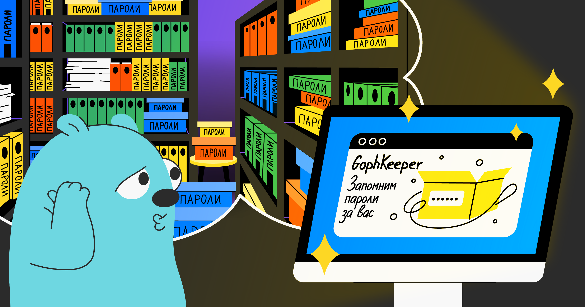

GophKeeper Password Manager
===============
### GophKeeper is a client-server system that allows the user to reliably and securely store logins, passwords, binary data and other private information.
---



Service use [Gateway](https://github.com/grpc-ecosystem/grpc-gateway).

Run go mod tidy to resolve the versions. Install by running

```sh
$ go install github.com/grpc-ecosystem/grpc-gateway/v2/protoc-gen-grpc-gateway
$ go install github.com/grpc-ecosystem/grpc-gateway/v2/protoc-gen-openapiv2
$ go install google.golang.org/protobuf/cmd/protoc-gen-go
$ go install google.golang.org/grpc/cmd/protoc-gen-go-grpc
$ go install github.com/googleapis/googleapis@latest
$ go install github.com/weblfe/go-swagger-merger
```

Generate stubs
```sh
$ scripts/proto.sh
```

Middleware problem. You may have to force the resource to be registered in go.mod.
```
require github.com/grpc-ecosystem/go-grpc-middleware/v2 v2.1.0
```

Swagger
```
http://localhost:8080/swagger
```

## CLI
---
### Client build
```sh
$ go build -o cmd/gkclient/gkclient cmd/gkclient/main.go
```

### Client Usage:
Register User
```sh
$ cmd/gkclient/gkclient reg --u <username> --p <password>
```

Login User
```sh
$ cmd/gkclient/gkclient login --u <username> --p <password>
```

Store Data
```sh
$ cmd/gkclient/gkclient post --t <token> --s <site> --l <login> --p <password> --m <metadata>
```

Get Data
```sh
$ cmd/gkclient/gkclient get --t <token> --s <site>
```